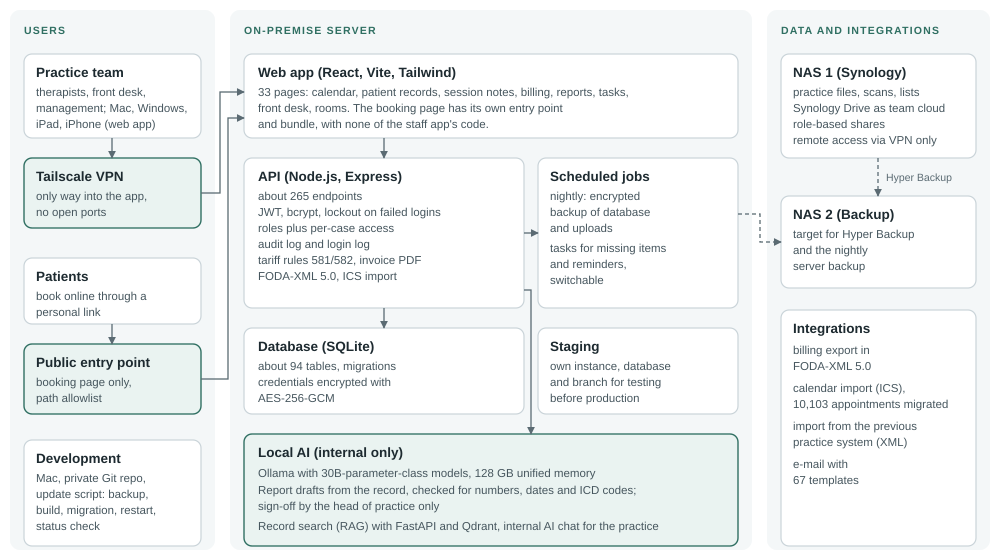

# Practice management app for a psychotherapy practice

An on-premise web app for a Swiss psychotherapy practice with about 12 staff. Scheduling, patient records, session notes, tariff billing, reports and team chat live in one system. It runs on the practice's own server, and so does its AI.

The source code belongs to the practice and is not public, because the app handles data under Swiss professional secrecy. This page describes the structure of the app and how I built it.

## Why it exists

Appointments lived in each therapist's private calendar. Waiting lists and holiday plans were spreadsheets. Billing ran in older practice software, and online bookings went through an external service. The app replaces that patchwork with one system that knows who may see what.

## At a glance

| | |
| --- | --- |
| Users | 15 accounts in three roles: therapists, front desk, management |
| Front end | React 18, Vite, Tailwind, installable as a PWA, 33 pages |
| Back end | Node.js and Express, about 265 API endpoints |
| Database | SQLite, about 94 tables, about 228 versioned migration steps |
| AI | Ollama with local models; record search in Python with FastAPI and Qdrant |
| Hosting | The practice's own server, reachable only through a VPN; only the booking page is public |
| Size | about 50,000 lines of code, more than 600 commits since May 2026 |

## Building blocks

- **Calendar.** Week, month, room and team views. Real overlaps block saving. Therapists release slots and the front desk books patients into them. Existing appointments came in through an ICS importer ([write-up](https://github.com/sprutedominik/ics-calendar-migration)).
- **Patient record.** Structured intake, diagnoses with ICD-10 and ICD-11, standard assessments, case history. Therapists see only the people assigned to them or whom they have treated.
- **Session notes.** One dialog after each appointment: took place, cancelled or no-show. Each section of a note can be marked as allowed in reports; internal notes never reach a report or the AI.
- **Billing.** Minutes in, tariff code and quantity out, plus PDF invoices and a FODA-XML 5.0 export ([write-up](https://github.com/sprutedominik/swiss-psychotherapy-billing)).
- **Reports.** The local model drafts, code fixes the parts that must not vary, a check compares the draft with the record, and the head of practice approves ([write-up](https://github.com/sprutedominik/local-ai-for-clinical-reports)).
- **Online booking.** Personal booking links, built as a replacement for the external service. The only public part of the app ([write-up](https://github.com/sprutedominik/patient-online-booking)).
- **Daily operations.** Room plan, front desk view, waiting list, a shared task pool, team chat, e-mail templates, and an import from the previous practice software with preview and duplicate check.

## Roles and privacy

Access follows the role and, for clinical data, the case. The front desk never sees clinical content. Clinical documents need an extra personal code. Every access, including denied access, is logged. The whole app is reachable only through the VPN, and a privacy review against the Swiss Federal Act on Data Protection came before rollout to the team.

## How it was built

I wrote the requirements, made the design decisions and sign off every release. The code was written with coding agents (Claude Code) in a workflow I set up: separate roles for requirements, build, tests, privacy, leak checks, UX and release, plus a separate review agent. Tests are the acceptance criterion, for example 48 checks for the scheduled jobs and 22 billing cases with fixed expected results. Release, staging and migrations are described in [deployment and operations](https://github.com/sprutedominik/deployment-and-operations).

## Stack

React · Vite · Tailwind · Node.js · Express · SQLite · node-cron · pdfkit · Pandoc · rrule · Python · FastAPI · Qdrant · Ollama · Tailscale
